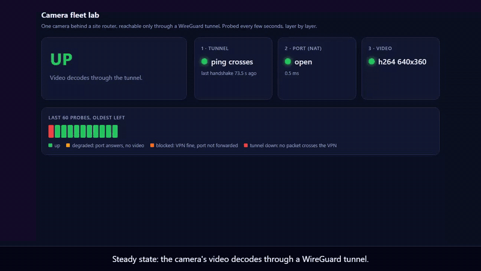
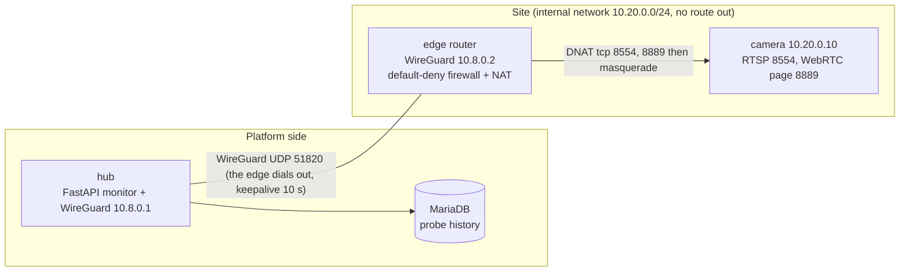

# camera-fleet-lab

[](https://github.com/Exalt24/camera-fleet-lab/actions/workflows/ci.yml)

Docker model of a remote camera site behind a WireGuard VPN, with a monitor that says which layer broke.



*The dashboard through both faults: the VPN drops (`tunnel down`), recovers, then the NAT rule disappears (`blocked`) while the tunnel stays healthy. Full-quality clip: [`docs/demo.mp4`](docs/demo.mp4).*

**Proof:** `scripts/verify.py` runs 16 end-to-end checks and injects both faults. In `docs/last_run.json` (one run on one machine) the monitor called the VPN drop `tunnel_down` after 4 s. It called the removed NAT rule `blocked` after 8 s. An earlier run, which I did not save, took 13 s for the VPN drop.

Everything runs in Docker on one machine: kernel WireGuard, `iptables` NAT and firewall, an RTSP camera, an async FastAPI monitor, MariaDB and a mosquitto MQTT broker for the smart lock slice.

The site router dials out and holds its NAT mapping open with a persistent keepalive, the way a 4G router has to. The camera sits on an `internal` network the hub is not on. The only path to it is the tunnel, and only TCP 8554 (RTSP) and 8889 (the WebRTC page) are forwarded.

The networking is real Linux behaviour, arranged as a Docker model of the remote site (see [Scope and next steps](#scope-and-next-steps)).

[`DEBUGGING.md`](DEBUGGING.md) has the two injected faults and the commands used to tell them apart. It also covers the wrong assumption I made and measured my way out of.

## The idea: probe in layers

```
tunnel  ->  port (NAT)  ->  video
```

Each layer fails for a different reason and needs a different fix. The monitor checks them in order and reports the
first one that fails:

| State | Meaning | Where to look |
|---|---|---|
| `up` | video decodes through the tunnel | nothing |
| `degraded` | the port answers but no video decodes | the camera or its encoder |
| `blocked` | packets cross the VPN, the camera port is silent | the NAT rule, the firewall, the camera being off |
| `tunnel_down` | no packet crosses the VPN at all | WireGuard, keys, endpoint, the 4G link |

## Topology

The GIF above shows the monitor reacting. This shows what it is monitoring, which a recording of the dashboard cannot.
The camera sits on a network the hub is not on. The only way to it is the tunnel and one DNAT rule.



Probe order on every cycle: ping through the tunnel, then a TCP connect to the camera port, then `ffprobe` over RTSP.
The first layer that fails is the one reported.

## Run it

Needs Docker with a kernel that has WireGuard (Docker Desktop's WSL2 kernel does). From this folder:

```
docker compose up -d --build
python scripts/verify.py          # 16 end-to-end checks, injects both faults, exit 0 only if all pass
# then open http://127.0.0.1:8100/ in a browser for the live dashboard
python scripts/measure_recovery.py 40     # block the VPN for 40 s and time the recovery
cd hub && pip install -r requirements.txt && pytest      # offline unit tests, no Docker needed
```

Short captioned screen recording of both faults: [`docs/demo.mp4`](docs/demo.mp4).

## Measured results

The first five rows are from `docs/last_run.json`. It is one run on one machine, so read them as orders of magnitude, not benchmarks. The last two come from `scripts/measure_recovery.py` and `scripts/soak_summary.py`. Those print to the terminal, and I did not save their output.

| Check | Result |
|---|---|
| Camera reachable only through the tunnel (no direct route from the hub) | pass |
| Stream decodes through the tunnel | h264 640x360 |
| Non-forwarded port on the site router | silently dropped |
| **Fault A**: WireGuard UDP blocked | detected as `tunnel_down` after **4 s** in the saved run (an earlier, unsaved run took 13 s: it depends where in the 5 s probe cycle the block lands, and whether the first symptom is a stalled stream that reads `degraded` for one cycle), recovered by itself **6.1 s** after unblocking |
| **Fault B**: DNAT rule removed (tunnel healthy) | detected as `blocked` after **8 s**, recovered **8.1 s** after the rule was restored |
| A 40 s VPN block, then unblocked | fresh handshake on both ends within **about 5 s** |
| Smart lock slice (`iot/`, one run, saved in `docs/iot/`) | 456 tests pass; 133 of 133 deliberate breakages turn a test red; the diagnosis tool named the induced layer in 17 of 17 runs |
| No-fault soak, about 5.5 minutes (`scripts/soak_summary.py`) | 43 probes, every one `up`; the handshake age climbed to 118 s and reset twice (two WireGuard rekeys). The first version's 30 s threshold would have called most of this "down" |

`verify.py`: **16/16** checks. `pytest`: 22 passed, 1 skipped (the skip is OS-specific, see below).

## What I got wrong (and how the stack showed me)

These are real. Items 1, 5 and 6 are pinned by a test or a check. Items 2 to 4 were found and fixed but have no regression test.

1. **I assumed persistent keepalive refreshes the WireGuard handshake. It doesn't.** My first version called the tunnel
   "stale" when the last handshake was older than 30 s. The probe history showed `state=down` with
   `tcp=True rtsp=True`. A working camera was reported dead, flapping every couple of minutes. Persistent keepalive only holds
   the NAT mapping open. WireGuard re-handshakes about every 120 s and a session lives up to 180 s. So a *healthy*
   tunnel's handshake age cycles from 0 to roughly 3 minutes. The monitor now decides whether the tunnel works by sending
   a packet through it (a ping). It reports the handshake age as information only. Regression test:
   `test_a_healthy_tunnel_with_an_old_handshake_is_still_up`.
2. **My monitor logged nothing.** uvicorn only configures its own loggers, so the app logger's `INFO` lines were silently
   dropped. I only noticed because I went to read them. An explicit `logging.basicConfig` fixed it.
3. **`asyncmy` has no Python 3.13 wheel and its compile fails**, so the image would not build. I switched to the pure-Python
   `aiomysql`.
4. **SQLAlchemy's pool pre-ping crashed on startup** with that driver pair (`ping() missing 1 required positional argument`).
   Moving to a newer SQLAlchemy fixed it (the hub pins 2.1 now).
5. **The first end-to-end run failed 4 of 15 checks** (an observation from that day, no output saved). Two were my test or image bugs: the hub image had no `ping`, and the
   WebRTC page answers `302` before `200`. The other two came from the wrong model in item 1 (the recovery check and the
   "tunnel still fresh" check).
6. **A closed-port unit test passed on Linux and failed on Windows.** Windows keeps retrying SYNs to a closed local
   port for about 2 s, so it looks like a timeout. The test is skipped on Windows with the reason written next to it.

## Security layer

`security/` adds log correlation, a playbook responder and a Junos configuration reviewer to this lab. It was built and tested against this Docker model of a camera site, planted and generated logs, and sample Junos configurations written from Juniper's documentation. The long version is in [`docs/security.md`](docs/security.md) and [`security/README.md`](security/README.md).

- **SIEM.** The Wazuh manager (4.14.10) runs behind `--profile security`, so `docker compose up` and `verify.py` are unchanged. Seven custom rules join the monitor's state changes, the edge router's firewall drops and an ssh log (the ssh log and one of the two sweeps are generated, and every alert names its source file). In `wazuh-logtest` the 5 planted logs fired the expected rules and the 2 benign logs fired none. `scripts/verify_security.py` ran 51 checks against the live lab, all passing, with real `alerts.json` lines for all seven rules. Run files: [`docs/security/`](docs/security).
- **Responder.** `security/respond.py` runs a YAML playbook per alert: enrich, notify, block, ticket. It defaults to a dry run, never acts twice on one alert id, retries with backoff, keeps a hash-chained audit trail and writes an evidence folder with a sha256 manifest. On the 9 live alerts a dry run changed nothing, and `--apply` blocked the two generated attacker addresses with `iptables` inside the edge container (read back, then removed). 52 tests, and 13 of 13 deliberate breakages turned a test red.
- **Junos review.** `security/junos_review.py` checks 16 things (filters, management services, BGP sessions, policies, logging) in a configuration file read as text. It found 27 of the 27 planted faults across four sample configs and nothing on the two clean ones, and 16 of 16 rule-removal mutants turned a test red. It was written from Juniper's documentation and never run against a Junos device.
- [`security/COMPLIANCE-MAP.md`](security/COMPLIANCE-MAP.md) lines each rule and playbook step up with a NIST CSF 2.0 subcategory, a HIPAA Security Rule citation and a SOC 2 criterion. It also lists the NYDFS 23 NYCRR 500 sections each piece supports. It is a reference mapping for this stack and is not legal advice.

## Vulnerability assessment and IAM

`security/vuln/` and `security/iam/` add a vulnerability scan with CVE triage, and single sign on with a TOTP code, to this stack. They were built and tested against the Docker model of the camera site, this repo's own services, saved real NVD, CISA KEV and FIRST EPSS answers, and two sample users. The long version is in [`docs/vuln-and-iam.md`](docs/vuln-and-iam.md).

- **Scan.** `security/vuln/scan.sh` runs Nuclei v3.11.1 with its 11,288 community templates on this repo's Docker networks, behind a scope guard that refuses any target outside loopback and this repo's subnets (75 tests, shared with `zap.sh`). It found 20 matches, all severity info. I fixed 12 (the API docs the hub served, and nine missing security headers), accepted 3 with a written reason (no TLS on loopback), and 5 only describe the service. A re-run found exactly the 3 accepted. Nuclei scanned Keycloak and the SSO proxy only up to their first redirect.
- **ZAP scan.** `security/vuln/zap.sh` runs a passive ZAP 2.17.0 baseline scan against the hub, and against the SSO proxy from its `/ping` page. It found 10 alert types, none High. I fixed the 3 real ones on the hub (a Content-Security-Policy that allowed inline script and style, and cacheable answers); a rerun of the hub found 2 Informational alerts.
- **CVE triage.** `security/vuln/cve_triage.py` builds a 15 component inventory, asks NVD, the CISA catalogue and EPSS, and ranks by known exploited, then EPSS, then CVSS, then reachable before internal. It works offline from saved answers. 3 components have no CPE entry, so they are reported UNKNOWN, not clean. Of 59 first matches, 42 are findings (41 FFmpeg, 1 Python), none known exploited, and 17 were set aside with a reason.
- **IAM.** Keycloak 26.8.2 (dev mode, behind `--profile iam`) and oauth2-proxy v7.15.6 put the dashboard behind single sign on with a required TOTP code, two roles, a 60 second access token and brute force detection. `security/iam/check_iam.sh` passed 39 of 39 live checks.
- **Sample users, for this lab only.** `viewer.sample` has the password `ViewerSample-2026` and `admin.sample` has `AdminSample-2026`. The client and cookie secrets are generated into a gitignored file.
- **Tests and limits.** 179 new offline tests and 41 new mutants, each of which turns a test red (70 of 70 across the security layer); none needs the network or Docker. Keycloak is in dev mode over plain HTTP, and NVD matches upstream versions, so a patched Debian package can show CVEs that are already fixed.

## Smart lock integration

`iot/` adds an IoT integration slice: a simulated MQTT smart lock on a real mosquitto broker, a stand in for a lock maker's cloud API written from a stated contract, a connector service that keeps a record in sync with both, and a diagnosis tool that names the layer that broke. It is all simulated: no real lock, vendor account or radio, and no Zigbee or Z-Wave. The write up is [`docs/iot.md`](docs/iot.md).

- **Connector and diagnosis.** The connector refreshes OAuth tokens one caller at a time, honours Retry-After, verifies signed webhooks inside a replay window, drops duplicate events, repairs a missed webhook by polling, and keeps tokens and access codes encrypted at rest and out of every log. `iot/iotlab/diagnose.py` probes broker, device, vendor cloud, OAuth, webhook and connector in order. 133 mutants of the guards each turn a test red.

## Layout

```
docker-compose.yml        the four containers and three networks
camera/mediamtx.yml       the stand-in camera (RTSP + WebRTC, ffmpeg test pattern)
edge/                     the site router: WireGuard, iptables NAT + firewall
hub/app/                  FastAPI monitor: probe.py (layers), db.py (pool), main.py (API), dashboard.html
hub/tests/                offline tests for the probe layer
scripts/verify.py         end-to-end proof, both faults
scripts/measure_recovery.py, history_transitions.py, capture_debugging.py
demo/record.mjs           Playwright recording of the dashboard through both faults
docs/                     last_run.json, debugging_capture.txt, demo.gif, demo.mp4, security.md, security/ (run files)
security/                 Wazuh rules and decoders, sensors, playbooks, respond.py, junos_review.py, vuln/ (Nuclei, ZAP, CVE triage), iam/ (Keycloak realm, checks), tests
scripts/verify_security.py  the live proof for the security layer
docs/vuln-and-iam.md      the scan, CVE triage and IAM write up
iot/                      the smart lock slice: lock simulator, vendor cloud stand-in, connector, diagnosis tool, tests (iot/README.md)
docs/iot.md               the smart lock slice write up, docs/iot/ holds its run files
```

## Scope and next steps

- **One machine.** Docker networks stand in for the internet, the site LAN and a 4G link. Next steps: model carrier-grade NAT, packet loss, MTU black holes and radio behaviour. Then run real router firmware.
- **The camera is ffmpeg's test pattern served by MediaMTX.** Next steps: ONVIF discovery and vendor cameras (Hikvision, Dahua, Uniview).
- **One camera and one site.** The monitor models a single device. A fleet adds a camera registry, per-site peers and
  scheduling.
- The credentials in `docker-compose.yml` are local values. The database is only reachable on an internal
  network.
