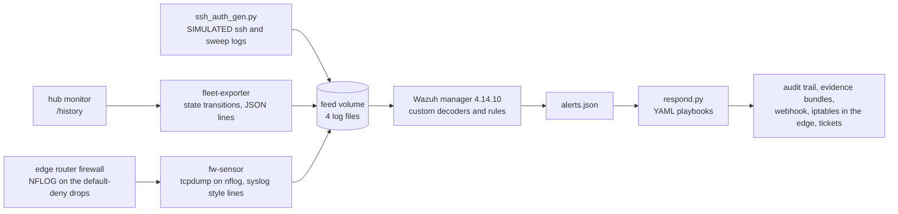

# Security layer: design notes and what the runs showed

The detail behind the short section in the [README](../README.md). The commands and file list are in [`security/README.md`](../security/README.md). Control mappings are in [`security/COMPLIANCE-MAP.md`](../security/COMPLIANCE-MAP.md).

Everything here was built and tested against the Docker model of the camera site, planted and generated logs, and sample Junos configurations written from Juniper's documentation. The run files that the numbers come from are in [`docs/security/`](security/) and [`docs/security_last_run.json`](security_last_run.json).

## The pipeline

The existing stack is not changed. The three new services (`wazuh`, `fw-sensor`, `fleet-exporter`) sit behind the compose profile `security`, so `docker compose up` and `scripts/verify.py` behave as before. `fw-sensor` joins the edge container's network namespace (`network_mode: service:edge`) and appends an NFLOG rule after the policy's own rules, which is why `edge/` is untouched. `fleet-exporter` reads the hub's existing `/history` API, so `hub/` is untouched too.

Measured and simulated sources are kept apart on purpose. `fleet_transitions.jsonl` and `edge_firewall.log` are written from the running lab. `ssh_auth.log` and `sim_firewall.log` are written by `security/simulate/ssh_auth_gen.py`, because the lab has no ssh server and no internet-facing router. Wazuh records the source file of each alert in its `location` field, so an alert says which kind it is.

## Detection rules

Seven rules raise alerts, two more are base rules the others count. All are in `security/wazuh/camera_fleet_rules.xml` with IDs from 100100 to 100301.

| Rule | Level | Fires when | ATT&CK | NIST CSF 2.0 |
|---|---|---|---|---|
| 100101 | 7 | the monitor reports `blocked` | none | DE.CM-01 |
| 100102 | 8 | the monitor reports `tunnel_down` | none | DE.CM-01 |
| 100103 | 10 | three `tunnel_down` transitions in 300 s | none | DE.AE-02 |
| 100210 | 10 | one address hits 8 different closed ports in 30 s | T1046 | DE.CM-01 |
| 100220 | 12 | a sweep, then `blocked` or `tunnel_down` within 300 s (two sources) | T1046 | DE.AE-03 |
| 100300 | 13 | a successful ssh login after a brute force from the same address | T1110, T1078 | DE.AE-02 |
| 100301 | 13 | an address that swept the router then logged in over ssh (two sources) | T1046, T1078 | DE.AE-03 |

The outage rules carry no ATT&CK id because an outage on its own is not attacker behaviour. The MITRE field and its format come from Wazuh's own rules (`<mitre><id>T1110</id></mitre>`), and the stock sshd rules in the same image use the same ids.

## What the runs printed

All from one run on one machine, so read the times as orders of magnitude. Sources: [`docs/security_last_run.json`](security_last_run.json), [`docs/security/`](security/), [`docs/security-mutation-run.txt`](security-mutation-run.txt).

| Run | Result |
|---|---|
| `wazuh-logtest`, planted logs | 5 files, 7 alerting rules, every rule fired as listed in `security/logs/EXPECTED.json` |
| `wazuh-logtest`, benign logs | 2 files (a quiet run of 8 lines and a near-miss file of 34 lines): none of the lab's rules fired. Stock rules 5715 and 5760 (an accepted login, a failed login) did |
| live: a real `blocked` fault on its own | monitor `blocked` after 4.6 s, rule 100101 alerted 2.9 s later |
| live: three real VPN drops | `tunnel_down` after 6.1 s, 6.7 s and 6.7 s; rule 100102 alerted twice and rule 100103 alerted 0.2 s after the third drop |
| live: a real sweep of 12 closed ports from the hub | the sweep took 14.9 s, rule 100210 alerted 0.3 s after it |
| live: the real fault again, after the sweep | monitor `blocked` after 7.7 s, rule 100220 alerted 3.0 s later |
| live: generated brute force, then generated sweep and login | rule 100300 alerted 3.3 s after the lines were written, rule 100210 (generated sweep) and rule 100301 1.7 s after the login |
| live: `alerts.json` | 9 lab alerts: 100101 once, 100102 twice, 100103 once, 100210 twice, 100220 once, 100300 once, 100301 once; 6 from the running lab, 3 from generated logs |
| `respond.py`, dry run over those 9 alerts | 9 done, `iptables` identical afterwards, no tickets, no posts |
| `respond.py --apply` | 9 notifications received (one retried after a 500), 9 tickets, both generated attacker addresses blocked in the edge container and read back, the hub's tunnel address left alone, the monitor still `up` |
| `respond.py --apply` again | 9 duplicates ignored, nothing acted on |
| audit trail and bundles | 108 audit lines, hash chain intact; 9 evidence bundles, all manifests verify |
| `scripts/verify_security.py` | 51 of 51 checks |
| `pytest security/tests` | 137 passed (61 Junos, 51 playbook engine including 20 seeded random runs, 15 Wazuh rule checks of which 7 run `wazuh-logtest`, 10 sensor and generator) |
| `run_mutations.py` | 29 of 29 mutants caught (16 Junos rules switched off one by one, 13 playbook engine breakages) |
| `junos_review.py` on the six samples | 27 findings, matching the 27 planted faults; the two clean configs report nothing |

One thing the table hides: the first four live runs passed 41 of 48, 42 of 48, 43 of 48 and 47 of 51 checks. The failures were findings about how the manager behaves live (items 1, 2, 7, 8 and 9 below), plus a check that ran before the manager had started its daemons. The fifth run is the 51 of 51 above.

## What I got wrong with Wazuh

Each of these was found by running it. Items 1, 2, 7, 8 and 9 only showed up on the live manager (the same sequences passed in `wazuh-logtest`, which runs lines in one fresh session with no files and no spacing in time), which is why the live run exists.

1. **A base rule at level 1 is not enough for a frequency rule on the live manager.** The sweep rule counts a base rule's events. With the base rule at level 1 (below the alert threshold of 3) `wazuh-logtest` fired the sweep rule, but the live manager never did. The base rule is now level 3 with `no_log`, so it is remembered for counting and never written to `alerts.json`. `wazuh-logtest` ignores `no_log` and reports the base rule as an alert, so the tests leave the base rules out of what they count.
2. **A log file that appears after the manager starts is read about a minute late.** The first sweep after a fresh start was missed. The sensors now create all four feed files, empty, and the manager starts after them (`depends_on`).
3. **`not_same_field` only compares dynamic fields.** With the destination port decoded as `dstport` (one of Wazuh's static fields) twelve drops to one port still counted as a sweep. The decoder names it `dst_port`, and a benign test file with twelve drops to one port now stays quiet.
4. **The stock rule 40112 (failures then a success) takes the event first.** My own rule for the same sequence never fired as a sibling. It is now a child of 40112 and adds the lab's mapping on the same event, which is stated in the rule's comment.
5. **A level 0 rule is not kept in the event history.** The monitor's JSON parent rule can stay at level 0 because nothing counts it, but a rule that other rules count cannot.
6. **An XML comment with a double quote or an apostrophe broke the whole ruleset load** (`Attribute '<!--' has no value`).
7. **Two log files are read in parallel, so a login written right after a sweep can be analysed first.** The first live attempt at rule 100301 failed that way: the manager alerted on the login in the same second as the sweep alert but before it. The generator now leaves a gap between the two (`--gap`, 3 s by default), which stands in for the minutes a real attacker would take.
8. **An outage rule can mask the flapping rule.** For five minutes after a sweep alert, rule 100220 matches every `blocked` or `tunnel_down` transition, and its `ignore` window then suppressed the flapping rule on three live tunnel drops: three alerts of rule 100102, no 100103. The live proof runs the flapping stage before the sweep for that reason. In a real deployment the two rules would need one clear precedence, which this lab does not settle.
9. **`ignore` is one timer per rule, not per source address.** The sweep rule first had `ignore="60"`, so a second address sweeping within a minute of the first raised nothing. In the live run the simulated sweep came 50 seconds after the measured one and was masked, and rule 100301 lost the sweep it needed. The sweep rule now uses `ignore="10"`, enough to collapse the four alerts a 12 port sweep would raise on its last four ports, and a second attacker within 10 seconds of the first would still be masked.

## The playbooks

`security/respond.py` reads `alerts.json` and picks a YAML playbook by rule ID. The steps are `enrich`, `notify`, `block` and `ticket`.

- **Dry run is the default.** Every step that would change something outside `security/state/` only records what it would do. `--apply` turns them on. A dry run does not use up an alert, so `--apply` can act on it afterwards.
- **Idempotency.** A SQLite ledger keys alerts by alert id and mode, and steps by alert id, mode and step name. The same alert id never acts twice in a mode. A failed alert can run again and its finished steps are skipped.
- **Timeout and retry.** Each step has a timeout, a retry count and a backoff that doubles. A 5xx answer and a timeout are retried. A 4xx answer is not, because a bad request cannot be fixed by sending it again.
- **Audit trail.** Every attempt is appended to `audit.jsonl` with the alert id, and each line carries the sha256 of the line before it, so `--verify-audit` catches an edited or removed line.
- **Evidence bundle.** One folder per incident: the alert JSON, the raw log lines around it (Wazuh's `previous_output` plus every line of the feed files within two minutes of the alert), the playbook result, the audit lines for that alert and a sha256 manifest. `--verify-bundle` catches a changed or missing file.
- **The block step.** It runs `iptables` inside the edge container only, checks with `-C` first so it never inserts a rule twice, and never blocks a protected address. The protected set is the hub's tunnel network, the site network, the wan network and loopback, so a response cannot cut the monitor's own path. The webhook it posts to is `security/webhook_receiver.py`, a local stand-in for a chat or paging service.

## The Junos reviewer

`security/junos_review.py` reads `set` format, which is what `show configuration | display set` prints. It reports findings with a rule id, a severity, the line, what is wrong and a fix.

| Rule | Finds |
|---|---|
| JR001 | a firewall filter with no final discard term |
| JR002 | a term that accepts any source to any destination |
| JR003 | ssh, telnet, netconf or snmp reachable from 0.0.0.0/0, or management services with no filter on lo0 |
| JR004 | telnet, http for J-Web, or ftp enabled |
| JR005 | root with a password and no ssh key, or ssh root login allowed |
| JR006 | the SNMP community `public` or `private` |
| JR007 | a term that can never match because an earlier term takes its traffic (filters and routing policies) |
| JR008 | a BGP neighbour without an authentication key |
| JR009 | an external BGP neighbour without a prefix limit |
| JR010, JR011 | an external BGP neighbour without an import policy, without an export policy |
| JR012 | a routing policy term that accepts everything (`then accept` with no `from`) |
| JR013 | a black hole style discard (policy next hop or static route) with no community |
| JR014 | a discard term with no count and no log |
| JR015, JR016 | no NTP server, no remote syslog host |

The sample configurations are in `security/junos/` and were written from the Juniper pages saved in `security/vendor-docs/`: the stateless firewall filter example (`protect-RE`, applied on `lo0`), the BGP `authentication-key` and `prefix-limit` statements, the SNMP `community` statement, the `ssh`, `telnet` and `web-management` services, `root-authentication`, NTP and syslog, and the discard interface example that shows the community match on a black hole next hop. `EXPECTED.json` lists every planted fault by rule and statement.

**Limits.** It was written from Juniper's documentation and run on sample configurations. It has never been run against a Junos device or a vJunos image. A statement form the documentation pages do not show may be read wrongly or reported as an unparsed line (it is never skipped silently). It reads `set` format only; configurations in brace format are recognised and the tool says to convert them. Terms in a filter are taken in the order they appear, and `insert` is applied.

## Limits of the whole layer

- One Wazuh manager, no indexer and no dashboard. Alerts are read from `alerts.json`.
- The ssh log and the sweep from an outside address are generated. Rules 100300 and 100301 were proven on generated logs, and the sweep part of 100301 and 100210 on both a measured and a generated sweep.
- The measured sweep comes from the hub's tunnel address, which the block step refuses to block. The block step was shown working on the generated attackers' addresses.
- The webhook is a local stand-in, not a chat service. No ticket system exists; a ticket is a JSON file.
- The compliance map is a mapping for a lab. It is not a compliance claim.
