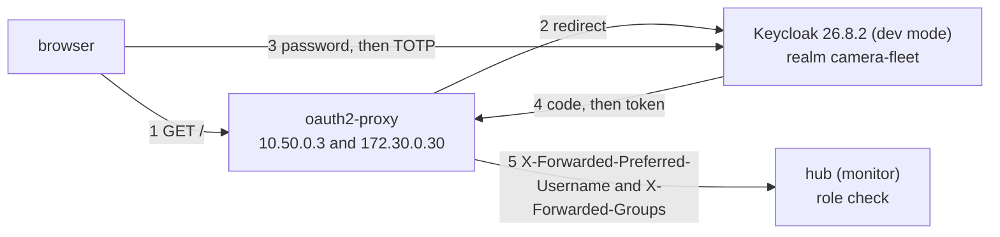

# Vulnerability assessment and IAM: design notes and what the runs showed

The detail behind the short section in the [README](../README.md). Commands and the file list are in [`security/README.md`](../security/README.md) parts D and E. Control mappings are in [`security/COMPLIANCE-MAP.md`](../security/COMPLIANCE-MAP.md).

Everything here was built and tested against the Docker model of the camera site, the lab's own services, saved real API responses (NVD, CISA KEV, FIRST EPSS) and two sample users. The run files that the numbers come from are in [`docs/security/vuln/`](security/vuln/) and [`docs/security/iam/`](security/iam/).

## Part A: Nuclei scan of the lab's own services

`security/vuln/scan.sh` runs the official `projectdiscovery/nuclei:v3.11.1` image on the lab's Docker networks against the three HTTP services the lab exposes: the monitor (hub, 172.30.0.10:8000), oauth2-proxy (10.50.0.3:4180) and Keycloak (10.50.0.2:8080). The community templates are downloaded by the image on its first run into a named volume (`11,288` signed templates were loaded). Interactsh is switched off, so nothing is sent to an outside server.

The scope guard runs before anything else, on every target including ones passed by hand. A target must be an `http` or `https` URL with an IP literal on a loopback address or inside one of the lab's subnets (`172.30.0.0/24`, `10.20.0.0/24`, `10.40.0.0/24`, `10.50.0.0/24`, `10.8.0.0/24`), or the name `localhost`. Any other host name is refused, because a name can resolve anywhere. So are credentials in the URL (`http://127.0.0.1@8.8.8.8`), a name that starts like an address (`127.0.0.1.evil.example.com`), octal and hex spellings (`010.050.0.1`, `0x7f.0.0.1`), the short form `127.1` and a leading `ftp://`. `security/tests/test_scan_scope.py` runs 36 cases against `scan.sh --check-scope`: loopback and lab addresses must pass with exit code 0, every outside address and every trick above must be refused with exit code 2, and a refused target next to a good one still stops the run. One refused target stops the run before Docker is touched.

The script exits non zero only on a real scan failure. This was seen on the first live attempt: the run started with the update check disabled, Nuclei found no templates, and the script exited 1 and printed the log tail instead of reporting an empty, clean scan.

### What the scan found

One run on one machine (`docs/security/vuln/nuclei_summary.txt`, `nuclei_results.jsonl`, `nuclei_run.log`): 11,288 signed templates, three targets, 23 minutes, **20 matches, all severity info; no low, medium, high or critical**. Triaged by hand:

| Matches | What it is | Verdict |
|---|---|---|
| `swagger-api`, `openapi`, `redoc-api-docs` (3) | FastAPI's interactive docs and OpenAPI document are served by the hub at `/docs`, `/openapi.json` and `/redoc` | **Real, fixed.** They are off unless `API_DOCS=1`. |
| `http-missing-security-headers` (10 matches, one per header) | The hub sent none of `x-content-type-options`, `x-frame-options`, `referrer-policy`, `permissions-policy`, `content-security-policy`, the three cross-origin policies, `x-permitted-cross-domain-policies` or `strict-transport-security` | **Real, 9 fixed.** The hub now sets the nine. `strict-transport-security` stays: it only means something over TLS and the lab speaks plain HTTP on loopback. |
| `cookies-without-secure` (1) | oauth2-proxy's CSRF cookie has no `Secure` flag | **Real, accepted.** `--cookie-secure=false` is deliberate for plain HTTP on loopback. The fix is TLS in front of the proxy, which the lab does not have. |
| `missing-cookie-samesite-strict` (1) | The same cookie is not `SameSite=Strict` | **Real, accepted.** It is now explicitly `SameSite=Lax`. Strict would stop the browser sending it back on the redirect from Keycloak, and the login would break. |
| `tech-detect` (1), `options-method` (2), `robots-txt` and `robots-txt-endpoint` (2) | The server is Uvicorn, the allowed methods, and oauth2-proxy's built in `robots.txt` | Not weaknesses: detection templates that describe the service. Nothing to fix. |

So 12 matches were fixed, 3 are accepted with the reason above and 5 are descriptions, not weaknesses. After the fixes a targeted re-run of the six templates behind those matches (`scan.sh --template-id ...`, `docs/security/vuln/rescan/`) found 3 matches, exactly the three accepted ones: the HSTS header, the cookie without `Secure` and the cookie without `SameSite=Strict`. The docs and OpenAPI matches and the other nine header matches were gone, and the dashboard still worked behind the proxy with the new headers (the IAM run below was repeated after the change).

The one cookie value Nuclei quoted (a 15 minute CSRF token of the proxy) is replaced by `REDACTED` in the saved result and log files.

**Coverage limit.** Nuclei dropped two of the three targets almost at once. oauth2-proxy and Keycloak answer with redirects to `http://localhost:8180`, which is the address the host's browser uses and is not reachable from the scanner's container, so Nuclei marked both "unresponsive permanently" after a redirect failed (`nuclei_run.log`). Both were scanned only up to their first answers. The hub, which does not redirect, got the whole template set. A scan of Keycloak and the proxy through their published ports from the host would need Nuclei installed on the host or a network namespace that shares the host's loopback; the lab does not do that. It also means the 20 matches say little about those two.

## Part A: CVE triage

`security/vuln/cve_triage.py` builds a component inventory from the files in the repo and asks three public sources about each component.

- **Inventory.** From `docker-compose.yml` (image tags: Wazuh 4.14.10, Keycloak 26.8.2, oauth2-proxy v7.15.6, MariaDB 11, MediaMTX), the Dockerfiles (Python 3.13-slim, Alpine 3.20, the distro packages) and the pinned requirements (FastAPI 0.162.0, Uvicorn 0.54.0, aiomysql 0.3.2; SQLAlchemy is a range, so its version is read from the built image). A floating tag or a package that no file pins is read from the running containers by `--resolve-images` and saved in `snapshots/image_versions.json`. The inventory has 15 components: aiomysql, Alpine Linux, FastAPI, FFmpeg, iptables (two versions, hub and router), Keycloak, MariaDB, MediaMTX, oauth2-proxy, Python, SQLAlchemy, Uvicorn, Wazuh manager and WireGuard tools.
- **NVD 2.0**, keyless. Requests are 6.5 seconds apart (the limit is five per 30 seconds) and retried on 403, 429, 503 and dropped connections. The query is `virtualMatchString` for the product with `versionStart` and `versionEnd` set to the installed version. `cpeName` was probed first and is not used: it matches against versions the CPE dictionary lists, and for a release the dictionary may not hold yet an empty answer cannot be told apart from a CVE-free version. Before the CVE search the tool asks the CPE dictionary whether the product exists at all. Zero entries means the search cannot say anything about it, so the component is UNKNOWN.
- **CISA KEV** catalogue JSON (1,781 entries, catalogue version 2026.11.13) and **FIRST EPSS** (59 scores).

The ranking rule, in order: known exploited (KEV yes, then KEV unknown, then no), EPSS highest first, CVSS highest first (v3.1, else v3.0, else v4.0, else v2), reachable before internal, CVE id. Reachable means the compose file publishes a port for the service that runs the component. A component's remediation line names the fixed version when an NVD range gives one (`versionEndExcluding`) and says plainly when it does not.

### Three kinds of answer that are not findings

The first live run listed 59 findings. Reading the top of the list showed that most were not findings, and the tool now says so instead of ranking them:

1. **A platform match.** NVD ties a CVE to a component with `vulnerable: false` when the component is the system the vulnerable software runs on. CVE-2020-29396 is an Odoo bug "when running with Python 3.6 or later" and CVE-2021-32052 is a Django bug "with Python 3.9.5+". Both matched Python 3.13.18. The tool now sets these apart (`excluded`, reason `platform`).
2. **A version at the edge of a range.** NVD's version filter counts the end of a range as inclusive. All 14 MariaDB CVEs of the first run had a range ending `before 11.8.9`, and the image holds exactly 11.8.9, the first fixed release. The tool compares the version with each range itself and sets these apart (reason `outside-range`). Tests use the real answer: 11.8.9 is outside, 11.8.8 is inside and the fixed version is 11.8.9.
3. **The one known exploited CVE.** The first run ranked CVE-2026-123158 first: in the CISA catalogue (added 2026-11-09, EPSS 0.19), CVSS 8.1, and the Alpine 3.20.10 router container is internal. It is an OpenSSH password authentication bypass on musl without PAM, "an example of a platform using musl libc without PAM is Alpine Linux". NVD ties it to Alpine as a platform. The vulnerable software is OpenSSH. `security/vuln/triage_checks.sh` read the router container: none of `openssh`, `openssh-server` or `openssh-client` is installed (`apk info -e` exit 3), there is no `sshd` on the path, and the only TCP listener is Docker's own DNS on 127.0.0.11. This is a false positive for this lab, and it stays visible in the report under the platform section with its KEV flag, because the same CVE would be a real finding on an Alpine host that runs sshd.

### What is left after triage

After the three exclusions the final run has 42 findings: 41 for FFmpeg 7.1.5 in the hub image and 1 for Python 3.13.18. None is known exploited. The highest EPSS is 0.0078 (FFmpeg, CVE-2026-66040), so the model puts every one of them under one percent for the next 30 days. Reachable here only means the hub publishes a port.

- **FFmpeg, 41 findings (CVSS 3 to 10; 16 name a fixed upstream release, 8.0 to 9.0, and none names a 7.1 release).** What the hub does with FFmpeg is one command: `ffprobe -rtsp_transport tcp -select_streams v:0 -show_entries stream=codec_name,width,height -of json <rtsp url>` with a 6 second kill (`hub/app/probe.py`, `ffprobe_rtsp`). Most of the CVEs are in code that command does not run: the PNG and APNG encoders (CVE-2026-66040, the top ranked), the VobSub subtitle demuxer (CVE-2026-64830), the RTP/ASF demuxer (CVE-2026-64834, which needs an ASF payload), the MOV, AVI, Matroska and HLS demuxers. FFmpeg picks its demuxer from the `rtsp://` address, so the file demuxers are not used. One CVE is on the path: CVE-2026-107696 (rank 14, CVSS 6.5), an endless RTSP 3xx redirect loop in `ff_rtsp_connect()` that a hostile RTSP server can use to hold a CPU core. The server here is the camera behind the tunnel. The probe kills `ffprobe` after 6 seconds, so a loop costs one probe cycle and reads as `degraded`, not a stuck monitor. The package is Debian's `7:7.1.5-0+deb13u1`, so some of the 41 may already be patched by Debian, and that was not checked (see limits). **Verdict: not exploitable through the probe as written, with CVE-2026-107696 as the one reachable case, bounded by the timeout. The remediation that would remove the whole row is to run `ffprobe` in a container of its own without the hub's NET_ADMIN, which this lab does not do.**
- **Python 3.13.18, CVE-2026-3087 (rank 4, CVSS 7.5).** `shutil.unpack_archive()` extracts a ZIP with a Windows drive path outside the target folder, and the CVE text says "Only Windows is affected". The hub runs Linux (`Linux` printed by the check) and no file in the repo calls `unpack_archive` (`triage_checks.txt`). **False positive for this lab.** NVD names no fixed 3.13 release.
- **Alpine, CVE-2026-123158, the known exploited one.** A false positive, written up above, and the check that showed it is in `docs/security/vuln/triage_checks.txt`.
- **MariaDB, 14 CVEs.** Outside range: the image holds 11.8.9, the first fixed release of each. Nothing to do.
- **UNKNOWN: aiomysql, MediaMTX and WireGuard tools.** No CPE product in the NVD dictionary. Not checked, and not clean.

### Limits

- NVD matches upstream versions. Debian and Alpine patch packages without changing the upstream number (the FFmpeg package here is `7:7.1.5-0+deb13u1`), so a distro package can show CVEs its maintainers have already fixed. The Debian and Alpine security trackers were not read.
- Three components have no CPE product in the NVD dictionary and are UNKNOWN: aiomysql, MediaMTX and WireGuard tools. Their own projects' advisories would have to be read.
- Reachable and internal come from published ports only. The rule does not know which process in a container listens on which port. FFmpeg and Python are marked reachable because the hub publishes port 8100, although `ffprobe` only reads the camera stream.
- The lookups run when someone runs them. There is no schedule and no watch for new CVEs.
- The saved answers are one day's data. `--offline` reproduces the report from them. It does not refresh them.

## Part B: IAM with TOTP and single sign on

Keycloak runs from `quay.io/keycloak/keycloak:26.8.2` in dev mode inside Docker only, behind the compose profile `iam`, and imports `security/iam/realm-camera-fleet.json`. The realm has two roles (`fleet-viewer`, and `fleet-admin` which includes it), the Configure OTP required action on both users, a 60 second access token, brute force detection (five failures lock the account for five minutes) and a confidential client for the dashboard that uses the code flow with PKCE and a loopback redirect. The client secret in the file is the placeholder `${CFL_DASHBOARD_CLIENT_SECRET}`; `setup.sh` writes the real one into the gitignored `security/iam/.env` together with the cookie secret and the Keycloak admin password.

oauth2-proxy v7.15.6 speaks OIDC to Keycloak (provider `keycloak-oidc`, `--allowed-role` for both roles). The browser reaches Keycloak as `localhost:8180` and the proxy reaches it as `keycloak:8080`, so Keycloak's hostname is fixed to `http://localhost:8180` (the issuer in every token) and the proxy is given the login URL for the browser and the token and key URLs for the network. The hub had no write or admin route, so this change adds one read only route, `/admin/probe-config`, that needs the `fleet-admin` role, and a `/whoami` that the dashboard uses to show who is signed in. The hub reads the headers the proxy sets and believes them only when the request comes from the proxy's fixed address (172.30.0.30), so a forged `X-Forwarded-Groups` sent to the hub's own published port is ignored (checked live and by 11 offline tests in `hub/tests/test_authz.py`).

`security/iam/check_iam.sh` is the live proof. It resets both sample users to the realm file's state through Keycloak's admin API, so it can be run again, and then runs three things: a `curl` check, `shots.cjs` (Chromium through Playwright, one screenshot per step) and `check_iam.py` (the protocol checks, standard library only, with a small RFC 6238 TOTP). The TOTP secret is read off the forced set up page, the same way an authenticator app would get it. A second client, `cfl-check`, is the only one that allows the password grant. It exists so the test can get a token whose age it controls, and a test checks that no other client allows it.

### What the run printed

One run on one machine (`docs/security/iam/check_iam_sh_run.txt`, the protocol part alone in `check_iam_run.txt`): **39 of 39 checks passed**, 1 from `curl`, 8 from Chromium and 30 from `check_iam.py`.

| Check | Result |
|---|---|
| An unauthenticated request for `/`, `/status`, `/history` or `/admin/probe-config` | 302 to the Keycloak login, no data |
| A forged `X-Forwarded-Groups: fleet-admin` sent to the hub's own port 8100 | 403 |
| A wrong password | refused, "Invalid username or password.", no session cookie |
| A correct password, no code | Keycloak shows the forced Configure OTP page (first sign in) or the OTP prompt (later ones); the dashboard stays behind the login |
| A wrong code, at set up and at sign in | refused, "Invalid authenticator code." |
| A correct password plus a valid TOTP code | reaches the dashboard; the proxy's session cookie is set only after the code |
| `viewer.sample` | the hub sees `fleet-viewer` only, reads `/status` (200), gets 403 on `/admin/probe-config` |
| `admin.sample` | gets 200 and the probe settings from `/admin/probe-config` |
| Access token lifespan | `exp` minus `iat` is 60 seconds; the token is accepted while fresh and the proxy sends it back to the login 60 seconds after it was issued |
| A browser session past the 45 second refresh point | renewed with its refresh token, still works |
| Ten wrong passwords for `viewer.sample` | all ten refused; Keycloak reported the account locked from the fifth (`numFailures=5`); the correct password was refused while locked; after an admin cleared the lock it was accepted again |

The code is not stored anywhere: each run computes it from the secret on the set up page, and resets both users first (no OTP credential, Configure OTP set again, lock cleared).

With the profile off, the base lab is unchanged for its own proof: `scripts/verify.py` passed 16 of 16 checks against the hub image rebuilt with the role check, the security headers and the docs switch (run against the `cfl-iam` project; its `docs/last_run.json` was not replaced).

### What the screenshots show

Read from the saved files in [`docs/security/iam/`](security/iam/):

- [`01-login-page.png`](security/iam/01-login-page.png): the Keycloak sign in page ("Camera fleet lab", username and password fields, one Sign In button) that an unauthenticated visit to the dashboard lands on, with the sample user name and a masked password typed in.
- [`02-otp-setup-required.png`](security/iam/02-otp-setup-required.png): after the correct password, "Mobile Authenticator Setup" with the warning "You need to set up Mobile Authenticator to activate your account", the list of authenticator apps and a QR code. The dashboard is not shown.
- [`03-dashboard-admin.png`](security/iam/03-dashboard-admin.png): the monitor dashboard after the code was accepted: "Signed in as admin.sample (fleet-admin, fleet-viewer)", state UP, tunnel, port and video lights green (h264 640x360), the strip of 60 probes green except one red `tunnel down` cell, from the hub restart that applied the header fix a few minutes earlier. This run was made after the fixes, so it shows the page working with the new security headers.
- [`04-otp-prompt.png`](security/iam/04-otp-prompt.png): a second sign in as the same user in a fresh browser: after the password the page asks only for a "One-time code".
- [`05-dashboard-viewer.png`](security/iam/05-dashboard-viewer.png): the same dashboard for the viewer: "Signed in as viewer.sample (fleet-viewer)".
- [`06-viewer-admin-route-403.png`](security/iam/06-viewer-admin-route-403.png): the viewer asking for `/admin/probe-config`: the body `{"detail":"needs the fleet-admin role"}`.

### Limits

- Keycloak runs in dev mode with its embedded H2 database. It is not a hardened or highly available deployment, and nothing here sets up an external database, TLS, a custom theme or an email server.
- The cookie is not marked secure because the lab speaks plain HTTP on loopback.
- Two sample users and two roles. No groups, no federation, no social login, no SSO into more than one application.
- The role check lives in the hub and only one route uses it. The lab has no other write route to protect.
- The brute force setting is Keycloak's. The proof shows the account locking after five failures and refusing the correct password while locked; it does not tune the thresholds.

## What I got wrong

1. **`http.cookiejar` dropped Keycloak's cookies.** The first protocol driver got a 400 from Keycloak on every login. The standard library's cookie jar mishandles the host name `localhost`, so the session cookie never came back. The driver keeps its own small per-host cookie store now.
2. **oauth2-proxy showed a sign in button instead of redirecting.** An unauthenticated request got a 403 page with a button. `--skip-provider-button` makes it a 302 to the login.
3. **The first token expiry check looked for 401 or 403 and failed.** The proxy sends an unauthenticated API call back to the login with a 302, and its log said "oidc: token is expired". The check accepts any answer that is not 200 and prints the status.
4. **`X-Forwarded-User` is the opaque subject id.** The hub first showed `f024cfda-...` as the user. `--user-id-claim` changes the email field, not that header. The proxy's `X-Forwarded-Preferred-Username` holds the name, and the hub reads that first.
5. **Keycloak's own admin token lives 60 seconds too.** The run died with a 401 from the admin API halfway through the lockout check. The admin client now asks for a new token when the old one is 30 seconds old.
6. **The first NVD queries asked for the wrong thing twice.** `cpeName` gives an empty answer that cannot be told from a CVE-free version when the dictionary may not list the release, and `virtualMatchString` with a version returned CVEs whose range ended at that version. Both are described above, and the second is pinned by a test on the real answer.
7. **A scanner can reach out.** The first Nuclei run printed `Using Interactsh Server: oast.online`. That is Nuclei's out-of-band check service, so a vulnerable lab service could have been made to call an outside host. The container was stopped and `-no-interactsh` is now in the script.
