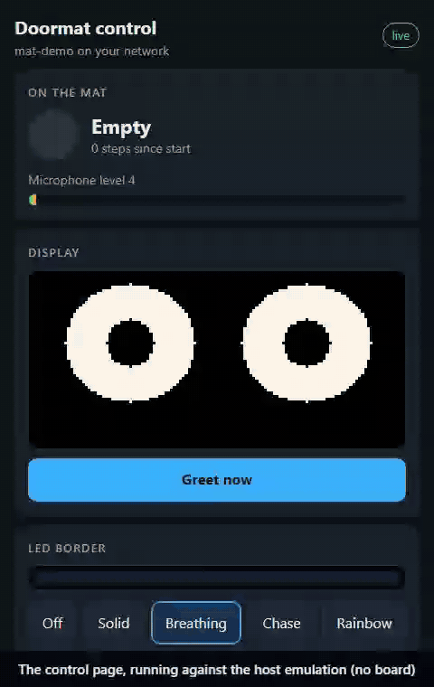
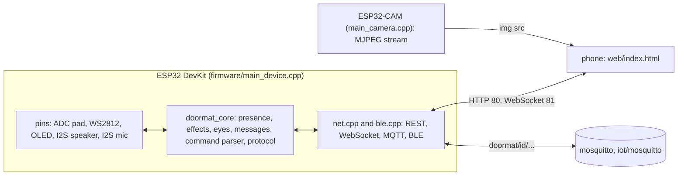

# Smart doormat firmware

ESP32 firmware and a phone control page for a smart doormat that greets a step with sound, eyes and LEDs. Tested in simulation, never flashed to hardware.



*The control page at phone width running against the host emulation (no board): LED modes, a step on the mat that triggers the greeting, a typed message and the camera stand in. Source: [`demo/record.py`](demo/record.py).*

**Proof:** `pio test -e native` ran 101 Unity test cases, all passing ([`docs/test-runs/native_tests.txt`](docs/test-runs/native_tests.txt)). The real firmware booted in Espressif's QEMU and printed the same 36 trace lines as the host build of the same C++ ([`qemu_run.txt`](docs/test-runs/qemu_run.txt)). It also ran in the Wokwi simulator and greeted a simulated step ([`wokwi_run.txt`](docs/test-runs/wokwi_run.txt)). 77 of 77 deliberate breakages of its guards turned a test red ([`mutation_run.txt`](docs/test-runs/mutation_run.txt)). One run each on one Windows machine.

## What it is

A doormat with a pressure pad, an LED border, a small display with eyes, a speaker, a microphone and a camera needs firmware, and a technician needs a way to flip modes from a phone. This folder is that firmware for an ESP32 DevKit, a second small firmware for an ESP32-CAM, a single page served by the board, and the tests that stand in for the board I do not have. It extends the repo's smart lock slice: the MQTT topics run on the same mosquitto broker and use its access list ([`iot/`](../iot)).

The device decisions (is someone standing there, what do the LEDs show, which message, what do the eyes do, is this command valid) are plain C++ in [`lib/doormat_core/`](lib/doormat_core) with no Arduino headers, so the same source runs on the board, in the native tests, in the host emulation and under QEMU. [`firmware/main_device.cpp`](firmware/main_device.cpp) only moves pins and radios in and out of it.

## Measured results

All numbers are from the run files in [`docs/test-runs/`](docs/test-runs), one run on one machine.

| What | Result |
|---|---|
| Unity tests on the host (`pio test -e native`, 8 suites) | 101 of 101 passed in 6.5 s |
| Host emulation tests (`pytest`: REST 33, MQTT on a real mosquitto container 8, control page in Chromium at 390 px 20) | 61 of 61 passed in 66 s |
| Mutation controls (`tests/run_mutations.py`) | 77 of 77 mutants turned a test red: 59 in the firmware logic, 6 in the host emulation, 3 in its MQTT bridge, 9 in the page |
| Firmware boots in Espressif QEMU 9.2.2 (`qemu/run_qemu.py`) | 36 of 36 trace lines identical to the host run, final frame hash `0x444c6e36` on both, finished in 1.4 s |
| Firmware in the Wokwi simulator (`wokwi/run_wokwi.py`) | scenario passed: slider up gave `STEP_ON raw=3686`, a greeting with "Welcome home!", slider down gave `STEP_OFF` |
| Firmware builds (`pio run`) | `esp32dev` 1,185,833 bytes of flash (37.7% of the 3 MB `huge_app` layout) and 62,992 bytes of RAM (19.2%); `esp32cam`, `esp32wokwi` and `esp32qemu` build too ([`firmware_builds.txt`](docs/test-runs/firmware_builds.txt)) |

The first mutation runs found three holes in my tests, which I closed: a greeting fade that started a second early passed, a body with a newline split the host emulation's line protocol, and a retained MQTT status was only checked by waiting for the next publish. It also showed three of my mutants were wrong (one read past a table, two changed nothing), so I replaced them. The saved run is the final run of all four groups.

## What the firmware does

| Ask | Where it is | How it was checked |
|---|---|---|
| Detects a person stepping on the mat | [`presence.cpp`](lib/doormat_core/presence.cpp): hysteresis band plus a debounce on each edge | unit tests, a seeded test of 200 random worlds, QEMU, Wokwi with a slider |
| LED border with at least 3 effects | [`effects.cpp`](lib/doormat_core/effects.cpp): solid, breathing, chase, rainbow, off and a greeting flash | unit tests on every frame generator, the page's border preview |
| Animated face with at least 3 messages | [`eyes.cpp`](lib/doormat_core/eyes.cpp), [`messages.cpp`](lib/doormat_core/messages.cpp): blinking, gaze, happy arches, 5 messages that rotate | unit tests, a Wokwi picture of the OLED ([`wokwi_oled.png`](docs/test-runs/wokwi_oled.png)) |
| Greeting sound | [`tones.cpp`](lib/doormat_core/tones.cpp): four rising notes as PCM through I2S | unit tests, and a WAV file whose pitches are measured; the amplifier code was never run |
| Microphone capture | I2S microphone, level on a dB scale from `micLevelFromSamples` | unit tests on the level maths; the I2S driver was never run |
| Phone connects and controls | [`web/index.html`](web/index.html) over REST, WebSocket, MQTT and BLE ([`docs/api.md`](docs/api.md)) | host emulation tests and Chromium tests; the firmware's servers were not run against a client |
| Camera view | the ESP32-CAM serves MJPEG; the page shows any stream address | the stream framing is tested against a generated test frame; the camera driver was never run |
| Wi-Fi and Bluetooth | station with an access point fallback; a BLE command characteristic | the access point started in Wokwi; BLE compiled and was not run |

## Architecture



The host emulation replaces the box on the left: `core_cli` is `doormat_core` compiled for the host, and `host/sim_server.py` adds the HTTP, WebSocket and MQTT servers and a clock.

## Run it

Needs Python 3.12 or newer and a C++ compiler (`g++`). The first PlatformIO run downloads the ESP32 toolchain.

```
pip install -r requirements.txt && python -m playwright install chromium
pio test -e native                    # 101 test cases, no hardware
pio run -e core_cli && python host/sim_server.py      # then open http://127.0.0.1:8080/?wsport=8081
python -m pytest                      # REST, WebSocket, the page in Chromium; MQTT needs Docker
```

Build the firmware with `pio run -e esp32dev` and the camera with `pio run -e esp32cam`. Building a firmware environment clears the other environments' build folders, so run `pio run -e core_cli` again before the host emulation or `pytest`.

QEMU: `pio run -e esp32qemu`, then `pio run -e core_cli`, then `python qemu/run_qemu.py --download` (fetches Espressif's QEMU into `.qemu/`). Wokwi needs a free token from wokwi.com and `wokwi-cli`: `set WOKWI_CLI_TOKEN=...`, `pio run -e esp32wokwi`, `python wokwi/run_wokwi.py --cli wokwi-cli`.

Flashing a board and getting a phone connected: [`docs/setup-guide.md`](docs/setup-guide.md), with the wiring table.

## Tests

| Command | Covers |
|---|---|
| `pio test -e native` | Unity suites: presence (14 tests, including 200 seeded random worlds), effects, messages, eyes, command parser (including a 20,000 case seeded fuzz), protocol, tones and the device brain with the scripted evening |
| `python -m pytest` | the host emulation over real sockets, the MQTT topics and the broker's access list, the control page at 390 px with screenshots in [`docs/test-runs/page/`](docs/test-runs/page) |
| `python qemu/run_qemu.py` | the real firmware image on the Xtensa core compared with the host trace |
| `python tests/run_mutations.py` | every guard broken one at a time; `--check-anchors` only checks that each break still applies, which CI runs |

## Limits

- **Simulation only.** No ESP32 board, pad, strip, display, amplifier, microphone or camera was used. The firmware compiles for the real chip, and everything below says how far each part was exercised.
- **QEMU runs the CPU, not the peripherals.** Its build replaces the pins with a scripted evening, so it proves the logic behaves the same on the Xtensa core, not that the ADC, I2S or LED driver work.
- **Wokwi ran a reduced build.** It has no Bluetooth controller, so the `esp32wokwi` build leaves BLE out. The diagram has a slider for the pad, an OLED and a 16 pixel ring, and no I2S parts, so the sound and microphone code did not run there. The ring renders black in its screenshots, so there is no LED picture.
- **Camera.** The `esp32cam` firmware compiles. The camera driver, the sensor and the live stream were never run. The MJPEG part header is tested, and the page is shown a generated test frame labelled as one. There is no two way audio.
- **Bluetooth.** One command characteristic and one status characteristic compile into `esp32dev` and were never run. There is no pairing, so anyone in radio range can write to it.
- **The firmware's network servers** (`net.cpp`) were compiled and started in Wokwi as far as the access point. REST, WebSocket and MQTT were tested through the host emulation, which shares the parser and not the server code.
- **Thresholds and timings** (1500 and 900 on a 12 bit reading, 60 ms and 400 ms debounce) come from reasoning about a pad on a voltage divider. They need a real pad and the serial monitor.
- Wi-Fi credentials are stored in the board's flash unencrypted, and the access point password is the default in [`config.h`](firmware/config.h).

## Stack

C++14 with the Arduino framework on PlatformIO (ESP32 Arduino core 2.0.17), Unity, Adafruit NeoPixel, GFX and SSD1306, arduinoWebSockets, PubSubClient, NimBLE-Arduino, I2S, Python with the standard library HTTP server, websockets, paho-mqtt, Playwright and pytest, Espressif QEMU 9.2.2, Wokwi CLI 0.29.1, mosquitto 2.0.22.
